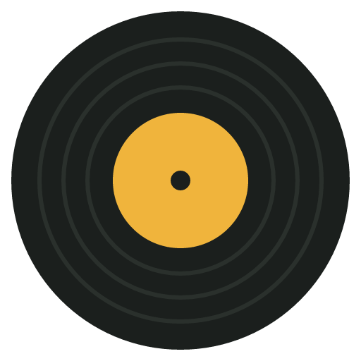
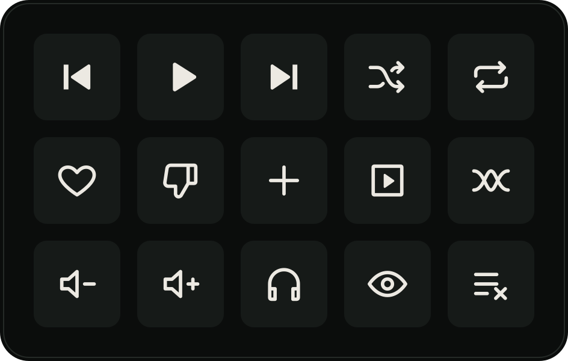

### Sona for Stream Deck

[](https://github.com/coredev-uk/sona-streamdeck/releases)
[](https://github.com/coredev-uk/sona-streamdeck/actions/workflows/ci.yml)
[](https://www.elgato.com/stream-deck)

Control [Sona](https://sona.coredev.uk), the Apple Music desktop client, from an Elgato Stream Deck. The keys show what Sona is doing and update the moment it changes.

[Download](https://github.com/coredev-uk/sona-streamdeck/releases) •
[Actions](#what-it-does) •
[Install](#install) •
[Sona](https://github.com/coredev-uk/sona-go)

<br clear="left">



> **Status: early.** Every action is tested against a running Sona through a stand-in for the Stream Deck app (`scripts/smoke.ts`). The plugin has not yet been tried on a physical Stream Deck. If something looks or behaves wrong, [open an issue](https://github.com/coredev-uk/sona-streamdeck/issues).

## What it does

<details>
<summary>Every key and dial</summary>

| Action | Press | Shows |
| --- | --- | --- |
| Play/Pause | Plays or pauses | Play or pause |
| Next, Previous | Skips; goes back (option: always the previous song, never a restart) | |
| Shuffle, Repeat | Switches shuffle; moves repeat off → all → one | Lit while on, and repeat one |
| Favourite, Suggest Less | Rates the playing song, or takes the rating back | Lit while rated |
| Add to Library | Adds the playing song to your library, or removes it | A check when it is there |
| Crossfade, Spatial Audio, Private Listening | Switches each | Lit while on |
| Volume Up, Volume Down | Changes the volume by a step (held, keeps going) | |
| Clear Queue | Press, then press again within 3 s: clears all but the playing song | "Clear?" while it waits |
| Now Playing | Plays or pauses | The title (scrolling when long) and the artist |
| Album Art | Plays or pauses | The playing song's cover |
| Album Art Grid | Plays or pauses | One part of the cover; place several keys in a block (2×2 up to 4×4) and set each one's place |
| Play Collection | Plays a playlist, album or station (option: shuffled) | Its cover, once picked from your library |

On a **Stream Deck +**:

- **Player Dial.**
  - Turning it changes the volume. Press it to switch to moving through the song, and press again to switch back.
  - On the screen, tap the middle to play or pause. Tap the left edge to go back, and the right edge to skip.
  - It shows the song, its cover and the volume or the position.
- **Queue Dial.** Turn it to browse the queue, then press or tap to play the song it shows. After a few seconds without a turn it goes back to the song that plays next.

Where Sona can't do something (Suggest Less without an Apple Music account, nothing playing), the key shows Stream Deck's alert. While Sona isn't running the keys are dimmed. They come back on their own once it starts.

</details>

## Install

Needs **Sona with `sona connect`** (check with `sona help connect`) and **Stream Deck 7.1** or newer, on macOS 12+ or Windows 10+.

1. Download `uk.coredev.sona.streamDeckPlugin` from the [releases](https://github.com/coredev-uk/sona-streamdeck/releases).
2. Open it. Stream Deck installs it.
3. Drag the actions from **Sona** in the action list onto your keys.

<details>
<summary>Finding Sona, and how the plugin talks to it</summary>

The plugin starts `sona connect` and keeps it running. It finds `sona` on its own:
- **macOS:** `/Applications/Sona.app` or `~/Applications/Sona.app`, or `sona` on your PATH.
- **Windows:** `%LOCALAPPDATA%\Programs\Sona`, where the installer puts it.

If it can't, any action's settings say so, and **Where Sona is** takes the full path to `sona` (`sona.exe` on Windows).

That one `sona connect` process speaks Sona's add-on protocol on its standard input and output ([Sona's add-on reference](https://github.com/coredev-uk/sona-go/blob/main/docs/addons.md)), and reaches the running Sona the way the `sona` command line does: over D-Bus on Linux, and over a socket on macOS and Windows that only your user can reach.

The plugin opens no network port and needs no pairing. It only downloads album covers, and only from Apple's artwork CDN.

</details>

## Contributing

Report bugs and request actions with [Issues](https://github.com/coredev-uk/sona-streamdeck/issues).

<details>
<summary>Building and testing the plugin</summary>

Node.js 24 (as the Stream Deck app runs it).

```sh
npm ci
npm run check          # type-check, tests, build, manifest validation
npm run assets         # redraw the images after changing src/render
npm run pack           # dist/uk.coredev.sona.streamDeckPlugin
```

**`scripts/smoke.ts`** runs the built plugin against your running Sona with no Stream Deck. It stands in for the Stream Deck app and checks every action:
- it lays out every action, presses keys and turns dials;
- it checks what the plugin draws and what it sends;
- it changes shuffle, repeat, crossfade and the volume, and puts each back;
- it plays nothing.

```sh
npm run build && node scripts/smoke.ts [-sona /path/to/sona] [-sheet /tmp/deck]
```

With a Stream Deck: `npx streamdeck link uk.coredev.sona.sdPlugin`, then `npm run watch`.

</details>

## Licence

Sona for Stream Deck is licensed under the GNU Affero General Public License v3.0, as Sona ([LICENSE](LICENSE)).
`ui/sdpi-components.js` is [sdpi-components](https://sdpi-components.dev) (MIT, its licence beside it).
It is not affiliated with Apple or Elgato.
